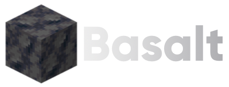

<p align="center">
  
</p>

<h2 align="center">Basalt Quarry</h2>

<p align="center">
  <strong>Extracts the data Basalt needs from the official Minecraft server jar.</strong>
</p>

<p align="center">
  
  
  
  
  
</p>

## Overview

Quarry is part of the Basalt Project. Basalt Server reimplements the game, and a lot of what it needs is a fact the
game keeps in code: which blocks exist and what shape they have, how hard each one is, which entities there are and
how big. Quarry reads those facts out of the official server jar, so a new Minecraft version is a rerun and not an
edit.

It is a Kotlin tool because extracting from the jar means running Mojang's own code: bootstrapping its registries and
asking it questions. That already needs a JVM, so Quarry lives in one. It is a separate repository and nothing from it
is part of the Basalt Server build; what leaves Quarry are data tables, which Server commits as C++.

It never redistributes anything from Mojang. The jar is one the developer downloaded themselves, and only the numbers
read from it leave.

## Building

Requires JDK 25. Gradle comes with the repository.

```bash
./gradlew installDist
```

The executable is `build/install/quarry/bin/quarry`.

## Usage

```
quarry extract <server.jar> [--work <dir>] [--java <java>] [--javac <javac>] [--heap <size>]
quarry version <server.jar>
```

`<server.jar>` is the bundler jar Mojang distributes (the one with `META-INF/versions/` inside), not the unpacked
server jar. `quarry version` prints the game version it carries.

`extract` does three things, in the work directory (`build/quarry/<version>` unless `--work` says otherwise):

1. Unpacks the bundler: the real server jar under `versions/` and its libraries under `libraries/`.
2. Runs the jar's own report generator (`--reports`) into `generated/`: the registries, the block states, the
   packets and the item components.
3. Compiles the harnesses in `src/main/resources/harness/` against the unpacked jar and runs them in one JVM,
   writing what vanilla keeps in code as tab-separated files under `dumps/`.

| Dump | Holds |
|---|---|
| `blocks.tsv` | Hardness, movement and note block instruments |
| `shapes.tsv` | Collision and outline shapes |
| `support.tsv` | Support rules, random ticks, conductors, piston reactions, fire odds, fuel |
| `items.tsv` | What the reports do not carry about items |
| `block_entities.tsv`, `entities.tsv` | Block entity and entity types, shapes and attributes |
| `world.tsv`, `map_colors.tsv`, `block_sounds.tsv` | Points of interest, biome order, map colours, block sounds |

A step that fails stops the run and names its log (`reports.log`, `javac.log`, `harness.log`) in the work directory.

## License

GPL-3.0-only. See [LICENSE](LICENSE).
